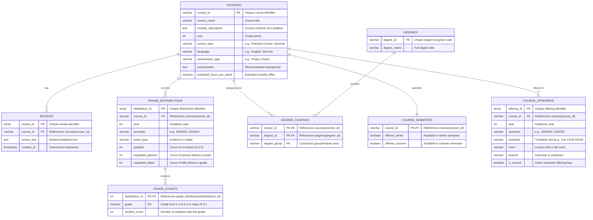

## Importing grade distributions

Connection settings come from `.env` (see `.env.example`).

```
pip install -r requirements.txt
python setup_db.py
python import_grade_distributions.py
```

The import reads `courses.json` from the [TUM Info API](https://mykolamor.github.io/tum_info/api/description) with a single request. You can run it again at any time: it updates existing rows and adds new ones, and an exam removed from the API stays in the table. If a run fails, nothing is saved.

If your database still has the older `grade10`, `grade13`, ... columns, `setup_db.py` stops with an error and changes nothing. Drop the table first, then run the commands above. The import fills it again:

```
psql -d course_compass -c 'DROP TABLE grade_distributions CASCADE;'
```

### How results are stored

- **Courses:** `course_id` is the TUM module number, such as `IN2227`. A course that doesn't exist yet gets a row with only its ID and name. Existing courses aren't changed.
- **Semesters:** winter semesters use the year they start in, so the API's `2023WS` (WS 2023/24) is stored as year `2023` and semester `WS2023`.
- **One row per exam:** each course, semester and exam type (`endterm` or `retake`) gets its own row in `grade_distributions`, so a student who sat both exams appears in both rows. An exam with no results gets no row.

| `grade` in the API | Stored as |
|---|---|
| `1.0` to `5.0`, including in-between grades such as `1.4` | A row in `grade_counts`, unchanged |
| `6.0` (no-show) | `grade5x` |
| `7.0` (passed without a grade), `8.0` (failed without a grade) | `ungraded_passed`, `ungraded_failed` |

An unknown grade or semester stops the import with an error, so no data is lost silently.

### Reading grade bands and averages

For charts, query the `grade_distribution_bands` view. It adds up `grade_counts` for each exam:

| Column | Grades included |
|---|---|
| `very_good` | 1.0 to 1.5 |
| `good` | 1.6 to 2.5 |
| `satisfactory` | 2.6 to 3.5 |
| `sufficient` | 3.6 to 4.0 |
| `failed` | 4.1 to 5.0 |
| `average_grade` | 1.0 to 5.0 |
| `average_passed` | 1.0 to 4.0 |

Averages leave out no-shows and results without a grade, and are `NULL` for an exam with no real grades.

```sql
SELECT year, semester, exam_type, very_good, good, satisfactory, sufficient, failed,
       average_grade, average_passed
FROM grade_distribution_bands
WHERE course_id = 'IN2227'
ORDER BY year, semester, exam_type;
```