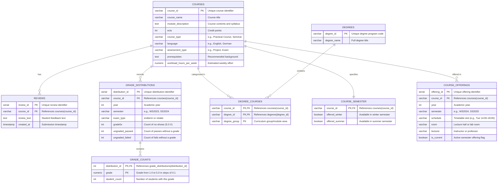

# Database schema

The tables are defined in [schema.sql](../src/course_compass/schema.sql). To create them, follow [Getting started](../README.md#getting-started).

The diagram shows tables only. The `grade_distribution_bands` view is described in [Grade distributions](grade-distributions.md#reading-grade-bands-and-averages).
